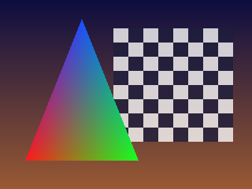

# nxgpu

Base de una GPU emulada, en Rust, con todo lo que se puede **verificar sin una GPU física**.

## Qué incluye
| Módulo | Qué hace | Cómo se verifica |
|---|---|---|
| `fifo` | Entradas GPFIFO y *pushbuffers* (modos incremental, no incremental, inmediato, incrementa-una-vez) | pruebas con búferes construidos a mano y leídos de memoria |
| `ir`, `asm` | IR de shaders (registros vec4, MOV/ADD/MAD/DP4/RCP/TEX…) y su ensamblador de texto | ida y vuelta ensamblar↔desensamblar, mensajes de error |
| `interp` | Intérprete de shaders en CPU | cada operación contra valores calculados a mano |
| `translate` | IR → WGSL → **SPIR-V (Vulkan)** y **MSL (Metal)** | validación con `naga` y relectura del SPIR-V generado |
| `raster` | Rasterizador por software: recorte, regla de relleno arriba-izquierda, perspectiva, profundidad, mezcla, texturas | aristas compartidas sin huecos ni solapes, interpolación contra fórmulas analíticas, recorte… |
| `engine` | Motor 3D de juguete que lee comandos del FIFO y dibuja | recorrido pushbuffer → imagen en memoria idéntico al dibujo directo |

`cargo test` ejecuta todo; `cargo run --example demo -- salida.png` genera la imagen de arriba.

## Qué NO hace (y por qué)
- **No decodifica shaders binarios reales** de la Switch (SASS de Maxwell/Ampere): las codificaciones de instrucciones
  no se pueden verificar aquí sin herramientas oficiales ni volcados.
- **No usa los registros reales** de los motores de NVIDIA: el motor de `engine.rs` es de juguete (clase `0xF3D0`).
- No hay backend Vulkan ni Metal: la traducción a SPIR-V y MSL sí existe y está validada, pero ejecutarla exige
  una GPU y un controlador. El rasterizador por software es la referencia con la que compararlos.
- Sin mipmaps, derivadas ni MSAA.

## Cómo encajaría en un emulador completo
Un servicio `nvdrv` del kernel (`nxemu`) recibiría las entradas GPFIFO del juego, `fifo::read_gpfifo` las decodificaría,
un motor con la tabla de registros real las interpretaría y un decodificador de shaders produciría este IR, que
`translate` convertiría a SPIR-V/MSL para un backend Vulkan (Android/PC) o Metal (iOS/macOS).
